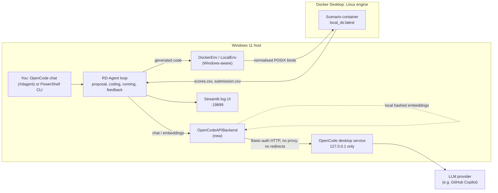

# RD-Agent on Windows, powered by OpenCode

[](#verification)
[](#quick-start-powershell)
[](pyproject.toml)
[](https://github.com/microsoft/RD-Agent)
[](LICENSE)

This is a port of **[Microsoft RD-Agent](https://github.com/microsoft/RD-Agent)**, an LLM agent that proposes, codes, runs and evaluates ML/data-science experiments. The upstream project supports **Linux only**. This port makes it run with **Windows as the host**. It sends every LLM call through the **OpenCode** desktop app, so RD-Agent itself stores **no provider API key**. Generated code still runs inside **Docker Desktop's Linux containers**.

> **What this repository is:** an independent engineering project by [@harpreetsinghiitd](https://github.com/harpreetsinghiitd) on top of RD-Agent 1.0.0 (`484776c`). It is not an official Microsoft release and is not endorsed by Microsoft. The original RD-Agent README is kept unchanged in [README_UPSTREAM.md](README_UPSTREAM.md).

---

## Highlights

| | |
|---|---|
| **New LLM backend** | [`rdagent/oai/backend/opencode.py`](rdagent/oai/backend/opencode.py), about 520 lines. It plugs into RD-Agent's `APIBackend` and talks to the locally signed-in OpenCode service over **authenticated loopback HTTP**. You can switch models by editing `.env` alone. Embeddings are computed locally and deterministically, because OpenCode has no embedding endpoint. |
| **Windows host runtime** | Docker volume normalisation, Docker Desktop autostart, a Windows `LocalEnv` (PATH handling, threaded output streams, `taskkill /T` timeouts, copy-based volume staging) and crash-proof cp1252 console output. |
| **Safety by default** | Generated code runs in Docker unless you deliberately choose otherwise. Qlib market data is **never downloaded or generated implicitly**. The OpenCode transport only talks to loopback, bypasses proxies, refuses redirects and redacts its password. |
| **Evidence, not claims** | 186 offline regression tests (mocked, with no network or Docker needed). A bounded live run went through the whole agent stage chain on a synthetic dataset. A written support matrix covers every RD-Agent entry point, and known gaps are listed openly. |

**Diff against upstream:** 21 files, about +2,460 / −310 lines. See `git diff 484776c`.

---

## Architecture



---

## Engineering problems solved

Each row is a concrete issue found while porting. The fix sits in the file named, with a regression test where one is practical.

| Symptom on Windows | Root cause | Fix |
|---|---|---|
| `WinError 206` (command line too long) on large prompts | The prompt was passed to `opencode-cli` as an argument, and Windows caps command lines at about 32 KB | Send the prompt over HTTP to the local OpenCode service instead. Verified live with a 40 KB prompt. *(opencode.py)* |
| HTTP 502 `The requested model is not supported` | Copilot's "Auto" is a routing mode inside the app, not a model id the API accepts | `auto` resolves once to a concrete model (`github-copilot/gpt-4.1`), with no hidden fallback chain. *(opencode.py)* |
| `mount denied … too many colons` | Container-side paths were built with `pathlib` and became `C:\kaggle\…` | Container paths stay POSIX (`posixpath`), and only host paths use Windows rules. *(env.py, `test_env_windows.py`)* |
| `includes invalid characters for a local volume name` | Docker treats a relative host path such as `./git_ignore_folder/...` as a *named volume* | Make host paths absolute before binding. *(env.py)* |
| `/tmp/full` bind fails | The Linux-only host cache path doesn't exist on Windows | The host cache moves to `%TEMP%\rdagent\{sample,full}`. *(env.py)* |
| `UnicodeEncodeError: '\u2839'` hid real build errors | A Rich braille spinner printed to a cp1252 console | Log build and pull progress as plain text. Console streams fall back to `errors="replace"`. *(env.py, logger.py, `test_console_encoding.py`)* |
| Cleanup command broke inside the container | Nested single quotes inside Docker's `sh -c '…'` wrapper | Use a `python -c` snippet with file names passed as arguments. *(data_science/conf.py)* |
| Workspace copy and archive failed | Calls to GNU `cp` / `tar` | Use `shutil` / `tarfile`. *(data_science/loop.py)* |
| Run aborted when Docker Desktop wasn't running | `docker.from_env()` fails immediately | Bounded autostart and wait (`RDAGENT_DOCKER_AUTOSTART`, `RDAGENT_DOCKER_WAIT`=180 s). *(env.py, `test_docker_reconnect.py`)* |
| Timeouts couldn't stop the generated process tree | POSIX process-group kill doesn't exist on Windows | `taskkill /T /F` returning exit code 124. Threaded stdout/stderr readers. *(env.py)* |
| Setting up a quant scenario could start a China-market data download without asking | `QTDockerEnv.prepare()` and the factor scenario fetched or generated data implicitly | Downloads now need `QLIB_DOCKER_AUTO_DOWNLOAD_CN_DATA=True` plus a host mount. Factor scenarios require prebuilt `.h5` files. *(env.py, qlib/experiment/utils.py, `test_no_implicit_data_download.py`)* |

## Security decisions

- **No API key in RD-Agent.** The backend reads OpenCode's per-user `service.json` in memory and sends Basic auth **only to a validated loopback address**.
- **The transport can't be hijacked by its environment.** `ProxyHandler({})` ignores `HTTP_PROXY`, and redirects are refused, so credentials can't be forwarded elsewhere. Mocked tests cover HTTP 401, timeouts, malformed JSON, rate limits and the missing-registration case. The password is redacted from errors.
- **Untrusted code runs in Docker.** The `local` backend is still available but documented as unsandboxed.
- **No silent data acquisition.** Qlib, Kaggle and Hugging Face downloads aren't triggered by setup code.
- **The log UI is treated as trusted-input only**, because upstream unpickles logs and renders scenario HTML.

---

## Verification

The numbers below come from the commands shown and were re-run on 2026-11-18. The gaps are listed openly.

| Check | Result |
|---|---|
| Offline regression suite (14 test files, mocks and temp fixtures, no network or Docker) | **186 passed, 2 skipped** (POSIX-only), 34.4 s |
| Live OpenCode completion through `APIBackend()` | ✅ real completion from `github-copilot/gpt-4.1` |
| Large-prompt transport (40,150-byte synthetic prompt) | ✅ |
| Docker run with artifacts written back to the Windows host | ✅ |
| Bounded data-science run on a **synthetic, non-clinical** dataset: proposal, code generation, Docker execution, evaluation, artifacts | ✅ every stage reached; `scores.csv` and `submission.csv` checked independently |
| Full multi-loop RD-Agent run | ⚠️ **Not yet.** It stopped at the configured step limit after `recover_ws_ckp … recovered twice` (see roadmap) |
| Upstream full test suite on Windows | ⚠️ Most of it needs live LLMs, Docker images, Qlib data or Linux paths, so it isn't a meaningful Windows signal yet |

Reproduce the offline suite:

```powershell
python -m pytest -q `
  test/utils/test_import_paths.py test/utils/test_archive_security.py test/utils/test_conda_security.py `
  test/utils/test_docker_reconnect.py test/utils/test_artifact_transport.py test/utils/test_env_windows.py `
  test/utils/test_env_posix_volumes.py test/utils/test_console_encoding.py `
  test/scenarios/data_science/test_secure_parsing.py test/scenarios/data_science/test_debug_data.py `
  test/scenarios/qlib/test_no_implicit_data_download.py `
  test/log/server/test_security.py test/oai/test_base.py test/oai/test_opencode_backend.py
```

The detailed evidence log, with commands, outputs and a support matrix for every entry point, is in [WINDOWS_PORT_CHECKLIST.md](WINDOWS_PORT_CHECKLIST.md).

---

## Quick start (PowerShell)

**Prerequisites:** Windows 10/11, Python 3.10 or 3.11, Docker Desktop (Linux engine), and the OpenCode desktop app signed in to a provider.

```powershell
git clone <this-repo-url> RD-Agent
cd RD-Agent
python -m pip install -e .
Copy-Item .env.example .env
```

Add these lines to `.env`:

```dotenv
BACKEND=rdagent.oai.backend.OpenCodeAPIBackend
OPENCODE_PROVIDER=github-copilot
OPENCODE_MODEL=auto
DS_Coder_CoSTEER_env_type=docker
DS_Runner_CoSTEER_env_type=docker
```

```powershell
python -m rdagent.oai.backend.opencode list-models   # models OpenCode can serve
python -m rdagent.oai.backend.opencode current       # the active provider/model
python -m rdagent.app.cli ui                         # log viewer at http://localhost:19899
```

To drive it from OpenCode, open the folder in OpenCode and type `/rdagent <your task>` in the chat. Step-by-step usage notes are in [HOW_TO_USE_RD_AGENT.txt](HOW_TO_USE_RD_AGENT.txt), and full configuration details are in [WINDOWS_OPENCODE.md](WINDOWS_OPENCODE.md).

---

## What changed, file by file

| Area | Files |
|---|---|
| OpenCode backend | `rdagent/oai/backend/opencode.py`, `rdagent/oai/backend/__init__.py` |
| Windows runtime | `rdagent/utils/env.py`, `rdagent/log/logger.py` |
| Data-science scenario | `rdagent/components/coder/data_science/conf.py`, `rdagent/scenarios/data_science/loop.py`, `…/dev/runner/eval.py` |
| Qlib data safety | `rdagent/scenarios/qlib/experiment/utils.py` |
| Tests (new or updated) | `test/oai/test_opencode_backend.py`, `test/utils/test_env_windows.py`, `test_env_posix_volumes.py`, `test_docker_reconnect.py`, `test_console_encoding.py`, `test_import_paths.py`, `test_import.py`, `test/scenarios/qlib/test_no_implicit_data_download.py` |
| OpenCode integration | `.opencode/commands/rdagent.md`, `.opencode/skills/rdagent-windows/SKILL.md` |
| Docs | `README.md`, `WINDOWS_OPENCODE.md`, `WINDOWS_PORT_CHECKLIST.md`, `HOW_TO_USE_RD_AGENT.txt` |

## Roadmap and known limits

- [ ] Fix `recover_ws_ckp … recovered twice` so a multi-loop data-science run completes end to end.
- [ ] Add a provider-injection point for `fin_quant`. Its validator hardcodes `SH600000` and 2008–2020 China data, so it is unsupported for now.
- [ ] Add Windows CI that runs the offline suite on every push. Upstream's Linux CI, release-please, Read the Docs and Dependabot workflows were removed from this repository because they target Microsoft's PyPI package, documentation site and release process.
- [ ] Split the work into small upstream pull requests: the OpenCode backend first, then the volume and path fixes.
- Out of scope: RL / AutoRL-Bench, which relies on POSIX process groups and Bash, and GPU fine-tuning. Clinical (Medical/ARF) scenarios are deliberately never run.

## Credits and license

RD-Agent is © Microsoft Corporation and released under the [MIT License](LICENSE), which this repository keeps. All upstream design, scenarios and research belong to the RD-Agent authors; see [README_UPSTREAM.md](README_UPSTREAM.md) and the [RD-Agent technical report](https://aka.ms/RD-Agent-Tech-Report). The Windows port, the OpenCode backend and the related tests and docs in this repository are the work of [@harpreetsinghiitd](https://github.com/harpreetsinghiitd).
